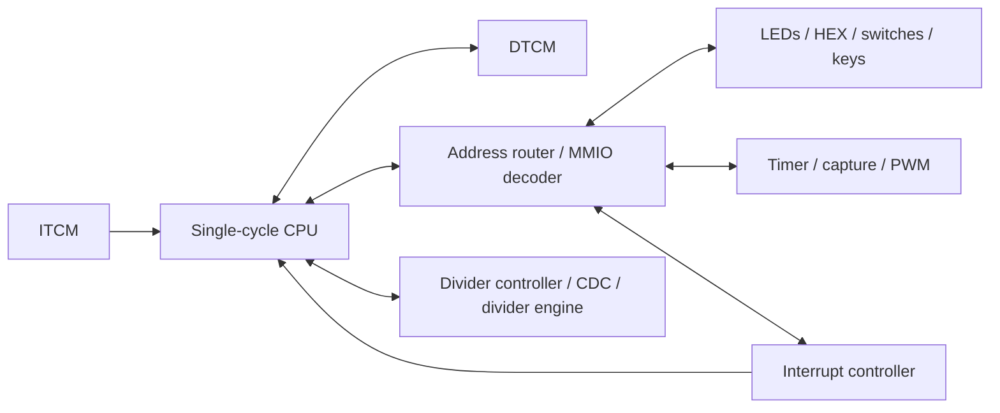

# Final project: MCU with peripherals

The final MCU integrates a **single-cycle RV32I-based CPU** with separate ITCM/DTCM memories and memory-mapped peripherals. Division stalls the CPU while a separate engine completes its operation; this is separate from the Lab 5 pipelined processor.

## Included hardware

- 32-bit datapath, register file, ALU, branch/jump logic and load/store unit.
- 2,048 instruction words and 2,048 data words in Intel `altsyncram` memories (8 KiB each).
- A 16-bit operand multiplier and a 32-bit engine for `DIV`, `DIVU`, `REM` and `REMU`.
- GPIO for eight LEDs, six seven-segment displays, eight switches and three active-low buttons. The board-facing ports expose ten LEDs/switches; their upper two bits are unused in the submitted design.
- Input synchronization, edge detection, interrupt entry/control and a programmable timer with compare, capture and PWM.
- PLL and synchronized reset; the testbench bypasses the PLL with `MODELSIM => 1`.

The historical entity name is `RV32IM_MCU`; this educational implementation is not presented as a complete, certified RV32IM ISA implementation.

## Files and build

| Path | Purpose |
| --- | --- |
| `rtl/` | All 31 submitted RTL files; `files.txt` gives compilation order |
| `tb/` | Submitted MCU stimulus testbench plus four existing unit testbenches |
| `programs/interrupt_demo/` | Matching test4 ITCM/DTCM images and course-provided assembly |
| `quartus/mcu.qpf` | Portable Quartus project for device `5CSXFC6D6F31C6` |
| `simulate.ps1` | Compile or execute the supplied testbenches |
| `synthesize.ps1` | Run Quartus Analysis & Synthesis |

Use the commands in the [root README](../README.md). Simulation runs the divider, interrupt-controller and two timer tests, then runs the submitted MCU stimulus for 100 us. The latter is a smoke run, not a self-checking end-to-end firmware test.

The Quartus project retains the final project's DE10-Standard pin assignments, including the external capture inputs and PWM output. Its memory-file parameters use repository-relative paths. Open `quartus/mcu.qpf` in Quartus for further implementation work. The provided command stops after Analysis & Synthesis; review the pinout and timing constraints before programming physical hardware.

The included assembly and HEX files are recovered artifacts, not a newly verified assembly build. The supplied images contain 304 instruction words and 1,024 data words; Quartus initializes the rest of each 2,048-word memory to zero and reports depth warnings. RTL and firmware behavior were preserved.
