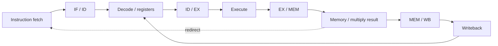

# Lab 5: five-stage pipelined processor

An RV32I-based processor with **IF, ID, EX, MEM and WB** stages, separate instruction/data memories and a pipelined multiplication datapath.

## Features

- Forwarding and stall units for data dependencies.
- Pipeline register control and branch/jump redirection.
- Lower-16-bit operand multiplication, built from four 8-by-8 partial products across EX and MEM.
- Debug outputs for each stage's PC/instruction and memory writes.
- `CLKCNT`, `STCNT` and `FHCNT` performance counters.
- Separate 2,048-word ITCM and DTCM memories using Intel `altsyncram`.

The historical top-level entity is named `RV32IM_CORE_pipeline`. This project adds the laboratory's limited multiplier to an RV32I-based core; it does **not** include the final MCU's divider or peripherals, or claim full RV32M compliance.

## Build and simulation

See the [root README](../README.md) for compile, synthesis and simulation commands. `rtl/files.txt` lists the 17 submitted hardware files in dependency order. The original `tb_pipeline` testbench and the RT5 memory images selected by the submitted top-level are included.

For simulation, `simulate.ps1` creates a temporary copy of `cond_compilation_package.vhd` under `build/sim/` with `G_MODELSIM := 1`. The committed package stays at `0` for FPGA synthesis. Memory filename defaults use `programs/rt5/`; no original machine path is needed.

The testbench logs data-memory stores and counters, detects the `0x00000063` completion instruction and has a 50,000-cycle timeout. The runner requires its completion marker. This is a completion smoke test, not an independent comparison of every output word.

`quartus/pipeline.qpf` targets Cyclone V `5CSXFC6D6F31C6` for Analysis & Synthesis. Its extensive debug ports are **virtual pins**; this configuration is not a physical board pinout or a ready-to-program bitstream.

RT5's recovered ITCM image holds 45 words and its DTCM image holds 1,024 words. Quartus zero-fills the remaining design memory and reports the depth mismatches. The recovered HEX files are included unchanged.
